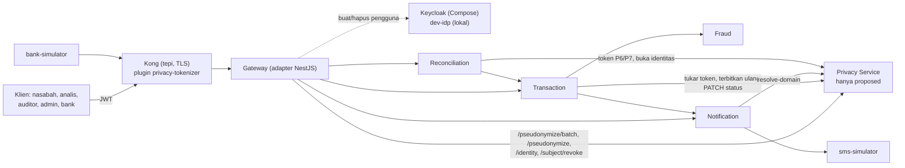

# Dokumentasi sistem PrivPay (dokumen hidup)

Dokumen rujukan tunggal tentang sistem PrivPay: apa tujuannya, bagaimana arsitekturnya, apa yang sudah dibangun, bagaimana menjalankan dan mengujinya, dan di mana keputusan serta catatan perubahan berada. Dokumen ini **diperbarui bersama setiap perubahan** (aturan di bagian 14). Bila dokumen ini bertabrakan dengan sumber kebenaran, yang menang adalah urutan di `CLAUDE.md`: ADR yang Accepted, PRD v2.4, lalu `docs/spec/` dan `docs/tickets/`.

- Terakhir diperbarui: 2026-11-12 (N-65, ADR-0020/0021, perbaikan CI, token unggahan, tahap C Transaction dan Notification).
- Pelengkap: [panduan/](panduan/README.md) (penjelasan untuk pembela skripsi; ditulis saat M5, beberapa bagian usang), [log/](log/README.md) (rencana, perubahan, masalah, satu berkas per tanggal), [HANDOFF.md](HANDOFF.md) (serah-terima per tiket), [CHANGELOG.md](../CHANGELOG.md), [adr/](adr), [OPEN_QUESTIONS.md](OPEN_QUESTIONS.md).
- Nilai pada semua contoh fiktif. Klaim yang belum diperiksa langsung atau belum dijalankan ditandai **belum diverifikasi**.

---

## 1. Tujuan dan ruang lingkup

Judul skripsi: **Implementasi Pola Arsitektur Privacy-by-Design Menggunakan Teknik Pseudonimisasi Dinamis pada Ekosistem Microservices.**

Masalah: pada sistem microservices data pribadi sering mengalir antar layanan tanpa kendali yang jelas. Rancangan ini mengubah data pribadi menjadi pseudonim di API Gateway atau layanan pertama, sehingga layanan hilir tidak pernah melihat data mentah kecuali benar-benar perlu.

PrivPay adalah e-wallet **prototipe** (artefak penelitian, bukan produk produksi) yang dibangun dengan standar rekayasa serius. Skripsi membandingkan dua kondisi (ADR-0003):

| Kondisi | Arti |
| --- | --- |
| `baseline` | identitas mengalir apa adanya ke layanan hilir |
| `proposed` | lapisan privasi: Gateway mengganti identitas jadi token pseudonim, Privacy Service memegang pemetaannya |

Di luar lingkup: produksi, pembayaran sungguhan, data pribadi asli (semua data uji fiktif dan jelas palsu).

## 2. Arsitektur

Pada fase lokal tanpa Docker (ADR-0004) tidak ada Kong: `gateway` adapter NestJS menggantikannya dan `dev-idp` menggantikan Keycloak. Pada tumpukan Compose, Kong 3.9.4 OSS ada di depan adapter (ADR-0015), plugin Lua `privacy-tokenizer` melakukan penyamaran di tepi (ADR-0016), Keycloak menjadi IdP (ADR-0017), dan ada tiga jaringan serta TLS Gateway-Privacy (DK-03).

### Invarian arsitektur (melanggar = bug keamanan)

1. Hanya Gateway dan Privacy Service yang boleh menerima `customer_id` atau nomor rekening mentah (dan NIK, nama dari formulir pendaftaran).
2. Layanan hilir meminta token baru dengan `source_pseudonym`, tidak pernah dengan `subject_id`.
3. Privacy Service tidak memanggil layanan lain; panggilan searah dari Gateway ke bawah.
4. Satu layanan satu basis data; tidak ada akses lintas basis data.
5. Token satu layanan tidak berlaku di layanan lain (tidak ada join lewat pseudonim).
6. Log aplikasi hanya memuat token dan `transaction_id`.
7. `requesting_service` selalu dari klaim JWT, tidak pernah dari body.
8. Privacy Service mati = gagal tertutup (503); tidak ada fallback ke data mentah.

## 3. Komponen

| Komponen | Lokasi | Tugas |
| --- | --- | --- |
| Gateway | `services/gateway` | Pintu tunggal klien: JWT, batas laju, validasi bentuk, tokenizer, penerusan ke hilir, kompensasi pendaftaran |
| Privacy Service | `services/privacy-service` | Menerbitkan dan memeriksa token, brankas identitas terenkripsi, Policy Engine, pembukaan identitas empat mata, audit, retensi, pencabutan |
| Transaction | `services/transaction-service` | Memproses transaksi (idempoten), mengorkestrasi Fraud dan Notification, mengabari Privacy tentang status |
| Fraud | `services/fraud-service` | Menilai risiko dengan aturan berbobot atas riwayat satu pelanggan (token) |
| Notification | `services/notification-service` | Menyimpan HP per pelanggan, mengirim SMS generik lewat simulator |
| Reconciliation | `services/reconciliation-service` | Mencocokkan transaksi `COMPLETED` dengan laporan bank; audit rutin tanpa identitas; meneruskan pembukaan identitas |
| bank-simulator, sms-simulator | `services/bank-simulator`, `services/sms-simulator` | Simulator (endpoint uji hanya bila env uji aktif) |
| dev-idp | `tools/dev-idp` | Penerbit JWT tiruan fase lokal |
| Kode bersama | `packages/common` | Konfigurasi, JWT, autentikasi, klien HTTP (timeout 3 s, maksimum 2 retry untuk operasi idempoten), pool database, migrasi, logger berredaksi, `Clock` |
| Plugin Kong | `services/gateway/plugins/privacy-tokenizer` | Lua: `core.lua` (tokenizer murni), `privacy.lua` (klien Privacy), `handler.lua` |
| Penerapan | `deploy/` | Compose (mode proposed/baseline), Kong, Keycloak, Prometheus, Grafana, ukuran |

Stack: TypeScript strict + NestJS, Node 24, pnpm workspaces; PostgreSQL (16 target; lokal 18, ADR-0004), driver `pg` + migrasi SQL maju-saja tanpa ORM; kripto hanya `node:crypto`; uji Jest + Supertest, Newman, k6.

Struktur tiap layanan, port, dan urutan baca berkas: lihat [panduan/02-layanan.md](panduan/02-layanan.md).

## 4. Token dan pseudonimisasi

Tujuh konteks token (PRD Tabel 1; kode: `services/privacy-service/src/policy/tables.ts`):

| ID | Layanan | Tujuan | Subjek | Dibuka? |
| --- | --- | --- | --- | --- |
| P1 | TRANSACTION | PAYMENT_PROCESSING | CUSTOMER | tidak |
| P2 | TRANSACTION | PAYMENT_PROCESSING | ACCOUNT | tidak |
| P3 | FRAUD | FRAUD_DETECTION | CUSTOMER | tidak |
| P4 | NOTIFICATION | NOTIFICATION | CUSTOMER | tidak |
| P5 | NOTIFICATION | NOTIFICATION_REGISTRATION | CUSTOMER | tidak |
| P6 | RECONCILIATION | DAILY_RECONCILIATION | ACCOUNT | tidak |
| P7 | RECONCILIATION | INTERNAL_AUDIT | CUSTOMER | **ya** (satu-satunya), peran `auditor`, lewat alur empat mata |

Bentuk token: `PSEU-` + 8 heksadesimal besar (13 karakter). Panjang token, tiga kunci terpisah, dan TTL tidak berubah tanpa ADR. Tiga kunci: untuk token (`K_token`, HMAC-SHA256), blind index (`K_index`), dan enkripsi field (`K_field`, AES-256-GCM, IV acak 12 byte per penulisan, AAD sesuai PRD 6.2). Kunci dibaca dari berkas lewat `<NAME>_FILE`.

Tiga bentuk `POST /pseudonymize` (spec privacy 4.1) dan rute batch (4.1a):

| Bentuk | Pemanggil sah | Isi |
| --- | --- | --- |
| 1 dari identitas | API_GATEWAY | `subject_type, subject_id, target_service, purpose, transaction_id?` |
| 2 pertukaran | TRANSACTION | `source_pseudonym, target_service, purpose, transaction_id` |
| 3 dari transaksi | RECONCILIATION | `subject_type, transaction_id, target_service, purpose` (P7 butuh aktor auditor) |
| batch (ADR-0019) | API_GATEWAY | `{requests: [bentuk 1, ...]}`, 1–2 elemen |

Aturan penerbitan (`buat_token`, spec 7.2): kunci advisory per kombinasi (subjek, layanan, tujuan); token aktif dipakai ulang (`reused`), yang lewat TTL ditandai `expired` lalu diterbitkan baru; indeks unik parsial `uq_mapping_active` menjaga satu token aktif per kombinasi; `transaction_link` (K-28) mengikat `transaction_id` ke token.

## 5. Kontrak API ringkas

Gateway (rute klien): `POST /register`, `POST /notification/register`, `POST /transaction`, `GET /transaction/held`, `POST /transaction/{id}/review`, `POST /reconciliation/audit-request|disclosure|run`, `POST /settlement/report`, rute disclosure/audit/pencabutan ke Privacy, `GET /health`, `GET /metrics`. Daftar AZ lengkap: [spec/endpoints.md](spec/endpoints.md).

Privacy Service (antar-layanan): `POST /pseudonymize`, **`POST /pseudonymize/batch`**, `POST /resolve-domain`, `POST /re-issue`, `PATCH /transaction-status`, `POST /identity`, `POST /pseudonym/{p}/revoke`, `POST /subject/revoke`, `POST /disclosure-requests` (+ `approve`, `reject`), `POST /de-pseudonymize`, `GET /audit-log` (+ `timeline`, `summary`), `GET /health`, `GET /metrics`. Kontrak: [spec/privacy-service.md](spec/privacy-service.md) bagian 4.

Aturan umum: JSON UTF-8, ISO 8601 UTC, `Authorization: Bearer <JWT>`, validasi zod yang menolak field tak dikenal, batas body 16 KiB pada Privacy, respons error seragam, dan ke klien eksternal hanya delapan `code` (ADR-0008). **Pemanggil dibuktikan dulu, baru body dibaca.**

### 5.1 `POST /pseudonymize/batch` (baru, ADR-0019)

- Body `{requests: [...]}` dengan 1–2 elemen bentuk 1; paling banyak satu elemen per `subject_type`; semua elemen memuat `transaction_id` yang sama (422 bila beda, N-65). Respons `{items: [{pseudonym, expires_at, reused}]}` sesuai urutan permintaan, tanpa `subject_id`.
- Satu transaksi basis data; tiap elemen melewati Policy Engine dan menulis tepat satu baris audit `GENERATE_TOKEN`.
- **Semua atau tidak sama sekali:** satu elemen ditolak berarti seluruh batch di-rollback, dengan satu baris `DENIED` dan tanpa pemetaan baru.
- Kunci diambil menurut urutan `subject_type` (bukan urutan permintaan) agar tidak deadlock; hasil tetap mengikuti urutan permintaan.
- Privacy atau DB tak terjangkau: 503 untuk seluruh batch tanpa fallback.
- Gateway (adapter dan plugin Kong) memakai rute ini untuk P1 dan P2 satu pembayaran, menggantikan dua panggilan.

## 6. Data

Satu instans PostgreSQL per layanan, objek berawalan `privpay_`, tanpa foreign key lintas basis data. Tabel dan skema per mode ada di `services/<nama>/migrations/{proposed,baseline}`.

Privacy Service (`privpay_privacy`): `pseudonym_mapping`, `transaction_status`, `identity_vault` (NIK, nama, HP, rekening, `customer_id`, terenkripsi per kolom), `disclosure_request`, `audit_log` (append-only lewat hak akses), `transaction_link`. Hak akses (`0002_privacy_grants.sql`): peran aplikasi hanya `INSERT` pada `audit_log`, peran auditor hanya `SELECT`. Constraint penting: `uq_mapping_active`, `chk_four_eyes`, `chk_purged`, `chk_mapping_complete`, `chk_attribute_names`.

Layanan hilir: kolom pseudonim di mode proposed (`customer_pseudonym`, `pseudonym`), kolom identitas asli di mode baseline. Perintah `pnpm db:migrate [layanan]` membuat/memperbarui database pengembangan (maju-saja, tidak menghapus, tidak otomatis).

## 7. Keamanan

- **Audit:** setiap operasi token menulis tepat satu baris (SUCCESS atau DENIED) di transaksi yang sama bila memungkinkan; audit hanya mencatat nama atribut, bukan nilainya. Penolakan keputusan = satu baris `DENIED` di transaksi tersendiri.
- **Larangan keras:** tidak menyimpan/mencatat NIK, nama, email, HP, nomor rekening, `customer_id`, `subject_id`, rahasia, JWT, atau nilai atribut hasil pembukaan di log, audit, error, trace, metrik, komentar, fixture, URL. Tidak ada kripto buatan sendiri. SQL selalu berparameter. TLS tidak dimatikan.
- **Pembukaan identitas:** alur empat mata (permintaan auditor, persetujuan admin berbeda), hanya atribut yang disetujui, hanya P7.
- **Pencabutan:** per token atau per subjek; Gateway boleh mencabut subjek `CUSTOMER` untuk kompensasi pendaftaran (ADR-0014).
- **Retensi:** identitas lama dikosongkan oleh tugas retensi; token dari baris itu tidak dapat ditukar lagi.
- **Gagal tertutup:** Privacy mati = 503; plugin Kong dan adapter memperlakukan jawaban yang bukan token sebagai `SERVICE_UNAVAILABLE`.
- **Batas ukuran, batas laju, token per audiens** (Keycloak, ADR-0017), kata sandi uji per kelas.
- **Rahasia:** `secrets/` tidak pernah di-commit atau dibaca; `.gitleaks.toml` + hook pre-commit; `.gitleaksignore` hanya tiga sidik jari riwayat lama (keputusan Fanny 2026-11-01). Tiga temuan `gitleaks --no-git` pada 2026-11-11 adalah kunci TLS dev di `secrets/docker/` yang di-gitignore (terverifikasi), bukan berkas yang akan di-commit.
- Model ancaman dan tinjauan: [security/](security) (threat-model, review per milestone, checklist).

## 8. Mode baseline dan proposed

Kode bisnis sama; yang berbeda hanya "colokan" (repositori/SQL, adaptor ke Privacy, port Gateway) yang dipilih di akar komposisi `*.module.ts` (ADR-0006). Baseline: `PassthroughPrivacyPort` meneruskan identitas apa adanya, tanpa Privacy Service. Proposed: `HttpPrivacyPort` memanggil Privacy. Tabel perbedaan lengkap: [panduan/00-peta-besar.md](panduan/00-peta-besar.md) dan [panduan/05-mode-baseline-proposed.md](panduan/05-mode-baseline-proposed.md).

## 9. Konfigurasi

Semua konfigurasi dari env yang divalidasi saat start (gagal cepat). Rahasia lewat `<NAME>_FILE`. TTL dan ambang dari env (PRD 17), bukan literal. Waktu lewat `Clock` yang bisa disuntik, selalu UTC. Variabel utama Privacy: `PRIVACY_MODE`, `IDP_URL`, `IDP_ISSUER`, `GRACE_PERIOD_SECONDS`, `TTL_<TUJUAN>`, `DISCLOSURE_APPROVAL_TTL_SECONDS`, `RETENTION_DAYS`, `PSEUDONYM_KEY_VERSION`, `PSEUDONYM_HMAC_SECRET_FILE`, `BLIND_INDEX_SECRET_FILE`, `FIELD_ENCRYPTION_KEY_FILE`, `PG_*`. Daftar penuh: `services/*/src/config.ts` dan [spec/platform-dan-ci.md](spec/platform-dan-ci.md).

## 10. Menjalankan dan memeriksa

Perintah resmi dan status ada di `CLAUDE.md` (bagian Perintah). Ringkasan:

| Tujuan | Perintah |
| --- | --- |
| Instal | `pnpm install --frozen-lockfile` (atau `corepack pnpm ...` bila `pnpm` tak ada di PATH) |
| Lint, tipe, build | `pnpm lint`, `pnpm typecheck`, `pnpm build` |
| Uji unit, integrasi, keamanan | `pnpm test`, `pnpm test:integration` (butuh PostgreSQL lokal), `pnpm test:security` |
| Uji Docker (Lua, tumpukan) | `pnpm test:edge` (spec `*.docker.spec.ts`) |
| Jalankan lokal | `pnpm dev:keys`, `pnpm dev:up [--mode baseline]`, `pnpm dev:down` |
| Tumpukan Compose | `pnpm docker:secrets`, `pnpm docker:compose <proposed\|baseline> up -d --build --wait` |
| Newman | `pnpm newman <proposed\|baseline>` |
| Pemindai PII | `pnpm pii-scan` |
| Rahasia | `pnpm secret-scan:tree`, `gitleaks detect --log-opts="--all" ...` |
| Kinerja (BUKAN resmi tanpa `--official`) | `pnpm perf:run ...` |

Aturan memori: gerbang penuh dengan Docker mati dan memori bebas minimal 5 GB; sesi dengan Docker menyala minimal 3,5 GB diukur setelah Docker menyala; berhenti bila kurang dari 0,5 GB. WSL laptop: memori 6 GB, 8 prosesor.

## 11. Pengujian

- Tes dulu (`/tdd`); nama tes memuat ID (`TK-07 ...`, `ADR-0019 ...`). Kasus negatif keamanan sama pentingnya dengan jalur sukses.
- Integrasi memakai PostgreSQL asli dan peran sungguhan (`privacy_app`, `auditor_role`); database tes `privpay_<layanan>_test_<sufiks>` lewat `createTestDb`.
- Tes konkurensi memaksa tumpang tindih tanpa `sleep` dan dibuktikan dengan mutasi.
- Dua lapis keamanan (TK-xx di layanan dan di Gateway), vektor kontrak Gateway di `tests/security/gateway-contract` yang dipakai TypeScript dan Lua.
- Jumlah tes terakhir (2026-11-11): unit 96 suite / 1663 tes lulus; integrasi penuh 70 suite / 1243 tes lulus (memori bebas 5,65 GB, Docker mati); setelah perbaikan review: unit 96 suite / 1664 tes, integrasi terarah 12 suite / 233 tes; `test:security` 24 lulus; `audit --prod` dan `gitleaks --all` bersih. Hasil gerbang lain dicatat di [log/2026-11-11.md](log/2026-11-11.md).
- Angka latensi/throughput lingkungan lokal tidak masuk laporan.

## 12. Kinerja dan perbaikan v2

Hasil v1 (resmi 2026-11-05, 100 pengguna, tanpa jeda): baseline p95 627,6 ms dan 203,9 req/s (n=5); usulan p95 1.600,4 ms (+155,0%) dan 62,6 req/s (-69,3%) (n=4). Penyebab dominan: sekitar 5,3 panggilan sinkron ber-TLS ke Privacy per pembayaran dan 6–8 query per panggilan; kriptografi (sekitar 4 µs) bukan penyebab. v1 dilaporkan apa adanya; v2 adalah iterasi kedua dengan protokol sama. Ambang 20% dan 15% tidak diubah.

| Tahap | Isi | Status (2026-11-11) |
| --- | --- | --- |
| A | `expireAndFindActive`: satu statement ganti dua | Kode dan tes selesai, commit `07b185c`. Belum diukur |
| B | `POST /pseudonymize/batch` untuk P1+P2 (ADR-0019 Accepted) | Kode, tes, dokumen selesai, commit `b52d31a`; `/code-review medium` selesai (perbaikan di commit berikutnya). Newman kedua mode, payload scan, dan fail-closed lulus (Docker); belum diukur |
| C | Cache token terbatas | ADR-0020 dan ADR-0021 Accepted (2026-11-12). Kode selesai untuk Transaction (X1/X2) dan Notification (P4 ke P5); T = 5 detik dari env `TOKEN_CACHE_TTL_SECONDS` (30 detik varian sensitivitas, 0 = mati). Gateway (P1/P2) ditahan: bertabrakan dengan K-28 (N-68, menunggu Fanny). Belum diukur |

Rencana dan harga keamanan tahap C: [PLAN_PERFORMA_V2.md](PLAN_PERFORMA_V2.md). Pengukuran resmi: [hasil/kinerja/](hasil/kinerja) (RENCANA-RUN-RESMI, RUNBOOK-dua-mesin). Berkas `resmi/` dan `resmii/` tidak pernah di-push.

## 13. Keputusan, batasan, dan hal terbuka

- Keputusan arsitektur: [adr/](adr) (0001–0021). Ringkasan keputusan desain: [DESIGN_DECISIONS.md](DESIGN_DECISIONS.md). Erata PRD: [PRD_ERRATA.md](PRD_ERRATA.md) (E-34 baru: rute batch).
- Pertanyaan terbuka: [OPEN_QUESTIONS.md](OPEN_QUESTIONS.md). Batasan dan pertanyaan untuk dosen: [panduan/08-batasan-dan-pertanyaan-dosen.md](panduan/08-batasan-dan-pertanyaan-dosen.md).
- Terbuka per 2026-11-12: CI GitHub gagal 0 detik sudah ditemukan penyebabnya (`hashFiles()` di `if:` tingkat job pada `lua` dan `e2e`, N-67) dan diperbaiki di berkas, tetapi belum terbukti di GitHub (butuh push, persetujuan Fanny); 10 PR Dependabot jangan di-merge sebelum CI terbukti hijau; commit lokal di depan `origin/main` belum di-push; verifikasi referensi naskah (OPEN_QUESTIONS bagian D); sisa gerbang tahap B dan pengukuran A+B tertahan aturan memori (lihat HANDOFF).

## 14. Cara menjaga dokumen ini tetap hidup

Aturan (permintaan Fanny, 2026-11-11): **setiap perencanaan, perubahan, dan masalah dicatat.** Pada setiap tugas:

1. Tulis di log kerja per tanggal, [log/](log/README.md): berkas `log/YYYY-MM-DD.md` untuk hari ini (buat bila belum ada, tambah baris di indeksnya): rencana, perubahan (dengan hash commit), masalah dan penyelesaiannya, keputusan.
2. Perbarui dokumen yang terpengaruh: bagian terkait di dokumen ini, `CHANGELOG.md`, `HANDOFF.md`, `docs/spec/`, ADR, `OPEN_QUESTIONS.md`, bagian Perintah di `CLAUDE.md` (dengan persetujuan Fanny), dan panduan bila perilaku yang dijelaskannya berubah.
3. Perbarui baris "Terakhir diperbarui" dan tabel riwayat di bawah.

Aturan yang sama ada di skill `privpay-working-style` (bagian Penutup tugas).

### Riwayat dokumen

| Tanggal | Perubahan |
| --- | --- |
| 2026-11-12 | Tahap C: cache exchange (Transaction) dan resolve-domain (Notification), env `TOKEN_CACHE_*`, N-68 |
| 2026-11-12 | N-65, ADR-0020/0021, perbaikan CI (N-67), token unggahan di header (N-66), status perintah CLAUDE.md |
| 2026-11-11 | Log kerja dipecah per tanggal (`docs/log/`); rujukan diperbarui |
| 2026-11-11 | Hasil Newman, payload scan, fail-closed, dan status tahap B diperbarui |
| 2026-11-11 | Hasil gerbang (security, audit, gitleaks) dan `/code-review` tahap B ditambahkan |
| 2026-11-11 | Dokumen dibuat. Memuat keadaan sampai kinerja v2 tahap B: rute `POST /pseudonymize/batch`, tahap A, rencana C |
