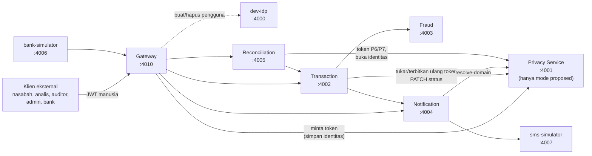

# 00. Peta besar

## Satu kalimat

PrivPay adalah e-wallet **prototipe** yang membuktikan satu hal: identitas pelanggan bisa dihilangkan dari hampir semua layanan hilir (transaksi, fraud, notifikasi, rekonsiliasi) **tanpa mematahkan fungsi bisnisnya**. Caranya: layanan hilir hanya melihat **token pseudonim** (`PSEU-XXXXXXXX`) yang berbeda untuk tiap layanan dan tujuan, sementara identitas asli hanya ada, terenkripsi, di satu layanan (Privacy Service). Skripsi membandingkan dua kondisi: **baseline** (identitas mengalir apa adanya) dan **proposed** (dengan lapisan privasi ini). Rujukan: [`docs/PRD_RINGKAS.md`](../PRD_RINGKAS.md) bagian 1, [`docs/adr/0003-hanya-dua-kondisi-pembanding.md`](../adr/0003-hanya-dua-kondisi-pembanding.md).

## Diagram: siapa memanggil siapa

Panah menunjukkan arah panggilan HTTP. Semua panggilan antar-layanan memakai JWT layanan dari dev-idp (tidak digambar agar tidak ramai); semua layanan juga mengambil kunci publik dev-idp lewat JWKS untuk memeriksa token.

Aturan yang membuat diagram ini bukan kebetulan (invarian arsitektur, aturan proyek):

1. Hanya Gateway dan Privacy Service yang boleh menerima `customer_id` atau nomor rekening mentah.
2. Layanan hilir meminta token baru lewat `source_pseudonym`, tidak pernah lewat `subject_id`.
3. **Privacy Service tidak memanggil layanan lain**; panggilan searah dari Gateway ke bawah. Satu-satunya yang diambil Privacy dari luar adalah kunci publik dev-idp untuk memeriksa JWT (`idpJwksSource` di [`packages/common/src/jwks.ts`](../../packages/common/src/jwks.ts)).
4. Satu layanan, satu basis data; tidak ada akses lintas basis data.
5. Token satu layanan tidak berlaku di layanan lain (tidak ada join lewat pseudonim).
6. Log aplikasi hanya memuat token dan `transaction_id`.
7. `requesting_service` selalu dari klaim JWT, tidak pernah dari body.
8. Privacy Service mati berarti **gagal tertutup** (503); tidak ada fallback ke data mentah.

Catatan jujur tentang diagram: Fraud **tidak memanggil siapa pun** di kode. Registri dev-idp mengizinkan Fraud meminta token untuk `privacy-service` ([`tools/dev-idp/src/registry.ts`](../../tools/dev-idp/src/registry.ts), `SERVICE_AUDIENCES.fraud`), tetapi `services/fraud-service/src` tidak memuat klien HTTP keluar. Itu izin yang tidak terpakai, bukan panggilan.

## Tanggung jawab tiap layanan (satu paragraf masing-masing)

| Layanan | Folder | Port lokal (dipakai panduan 01) | Tugas |
| --- | --- | --- | --- |
| Gateway | [`services/gateway`](../../services/gateway) | 4010 (pilihan panduan; repo tidak menetapkannya) | Satu-satunya pintu klien eksternal. Memeriksa JWT dan batas laju, memvalidasi bentuk, **mengganti identitas jadi token** (tokenizer), meneruskan ke hilir. Di pengganti Kong (ADR-0004) |
| dev-idp | [`tools/dev-idp`](../../tools/dev-idp) | 4000 | Penerbit JWT tiruan untuk fase lokal (pengganti Keycloak). Bukan layanan bisnis |
| Privacy Service | [`services/privacy-service`](../../services/privacy-service) | 4001 | Menerbitkan dan memeriksa token, menyimpan brankas identitas terenkripsi, Policy Engine (Tabel PRD), pembukaan identitas bersyarat, audit, retensi |
| Transaction | [`services/transaction-service`](../../services/transaction-service) | 4002 | Memproses transaksi (idempoten), mengorkestrasi Fraud dan Notification, mengabari Privacy tentang status, review transaksi yang ditahan |
| Fraud | [`services/fraud-service`](../../services/fraud-service) | 4003 | Menilai risiko dengan empat aturan berbobot atas riwayat satu pelanggan (token atau `customer_id`) |
| Notification | [`services/notification-service`](../../services/notification-service) | 4004 | Menyimpan nomor HP per pelanggan (satu-satunya data pribadi di luar Privacy dan IdP) dan mengirim SMS generik lewat simulator |
| Reconciliation | [`services/reconciliation-service`](../../services/reconciliation-service) | 4005 | Mencocokkan transaksi `COMPLETED` dengan laporan bank, menyediakan audit rutin (tanpa identitas) dan meneruskan pembukaan identitas |
| bank-simulator | [`services/bank-simulator`](../../services/bank-simulator) | 4006 | Mengirim laporan penyelesaian palsu ke Gateway (hanya bila `BANK_SIMULATOR_TEST_ENDPOINTS=true`) |
| sms-simulator | [`services/sms-simulator`](../../services/sms-simulator) | 4007 | Menampung SMS di memori; endpoint pembacanya hanya hidup bila `SMS_SIMULATOR_TEST_ENDPOINTS=true` |
| `packages/common` | [`packages/common`](../../packages/common) | tidak berjalan | Kode bersama: konfigurasi, JWT, autentikasi, klien HTTP, pool database, migrasi, logger, penjadwal, kerangka layanan Nest |

Rincian tiap layanan ada di [02-layanan.md](02-layanan.md).

## Dua lapis pemisahan yang perlu dihafal

1. **Pemisahan layanan.** Tiap layanan hanya tahu "rujukan subjek" miliknya: token P1/P2 di Transaction, token P3 di Fraud, P4/P5 di Notification, P6/P7 di Reconciliation (Tabel 1 PRD, lihat [04-keamanan.md](04-keamanan.md)). Dua layanan tidak bisa mencocokkan orang yang sama lewat token, karena tokennya berbeda.
2. **Pemisahan mode.** Kode bisnis sama untuk baseline dan proposed (ADR-0006). Yang berbeda hanya "colokan": repositori/SQL, adaptor ke Privacy, dan pintu Gateway. Lihat [05-mode-baseline-proposed.md](05-mode-baseline-proposed.md).

## Apa yang hanya ada di satu mode

| Komponen | Hanya proposed | Hanya baseline |
| --- | --- | --- |
| **Privacy Service** (proses, database `privpay_privacy`, semua tabelnya, migrasi `services/privacy-service/migrations/proposed`) | ya; menolak start bila `PRIVACY_MODE=baseline` ([`services/privacy-service/src/config.ts`](../../services/privacy-service/src/config.ts)) | tidak ada |
| Gateway: `HttpPrivacyPort` ([`services/gateway/src/tokenizer/http-privacy-port.ts`](../../services/gateway/src/tokenizer/http-privacy-port.ts)) | ya | |
| Gateway: `PassthroughPrivacyPort` ([`services/gateway/src/baseline/passthrough-privacy-port.ts`](../../services/gateway/src/baseline/passthrough-privacy-port.ts)) | | ya |
| Transaction: `ProposedSubjectReferences`, `HttpPrivacyClient` (tukar/terbitkan ulang token, PATCH status) | ya | |
| Transaction: `BaselineSubjectReferences`, `BaselinePrivacyStatus` | | ya |
| Notification: `HttpPrivacyClient` (resolve-domain) | ya | |
| Notification: `BaselinePrivacyClient` | | ya |
| Reconciliation: `HttpPrivacyClient` | ya | |
| Reconciliation: `BaselinePrivacyClient` (rekening dari Transaction; audit/pembukaan dijawab 503) | | ya |
| Kolom pseudonim di tabel hilir (`customer_pseudonym`, `pseudonym`, dst.) | ya | |
| Kolom identitas asli di tabel hilir (`customer_id`, `account_number`) | | ya |
| Variabel `PRIVACY_SERVICE_URL` | **wajib** | **dilarang** (start ditolak) |
| `GET /transaction/{id}` memuat `account_number` | tidak pernah | ya (N-46) |
| Audit log, token, pembukaan identitas, retensi, revocation | ya | tidak ada |

Yang **sama** di kedua mode: autentikasi (JWT), otorisasi per peran, batas laju, validasi skema, idempotensi transaksi, aturan fraud, mesin status transaksi, rekonsiliasi (pencocokan), format error. Itu sebabnya perbedaan hasil pengukuran bisa dikaitkan ke lapisan privasi (ADR-0006, bab [05](05-mode-baseline-proposed.md)).

## Status proyek (per penulisan panduan)

> **Pembaruan 2026-11-11:** bagian ini ditulis saat M5 dan sebagian usang (Docker/Compose, Kong, Keycloak, Newman, dan k6 kini ada; kinerja v2 tahap A dan B selesai). Keadaan terbaru ada di [`docs/DOKUMENTASI_SISTEM.md`](../DOKUMENTASI_SISTEM.md) dan [`docs/LOG_KERJA.md`](../LOG_KERJA.md).

- Milestone M0 sampai M5 selesai di `main` lokal; gerbang terakhir hijau (unit 1340, integrasi 1134, smoke 36, pii-scan 35 + 116 tes; [`docs/HANDOFF.md`](../HANDOFF.md)).
- **Belum ada**: Docker/Compose, Kong dan plugin Lua, Keycloak, Newman (M6), pengukuran k6 dan E(s) (M6/M7). Angka latensi dari mesin lokal sengaja belum diukur dan tidak masuk laporan.
- Rincian keterbatasan: [08-batasan-dan-pertanyaan-dosen.md](08-batasan-dan-pertanyaan-dosen.md).
