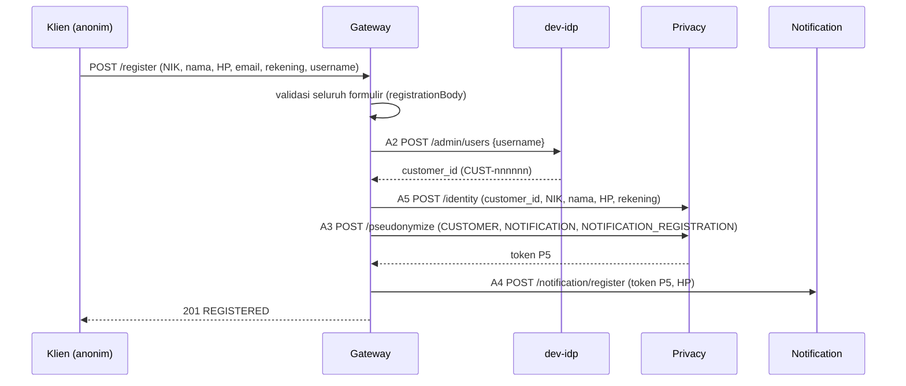
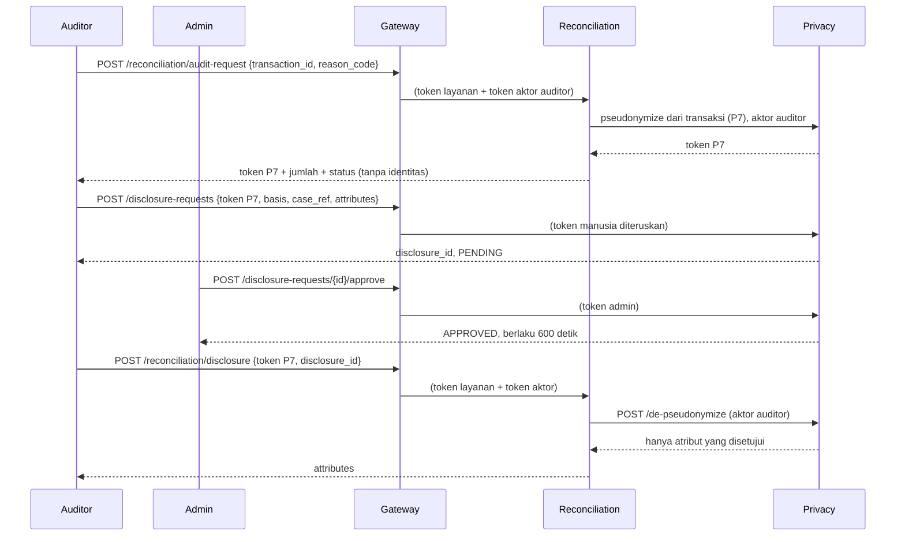
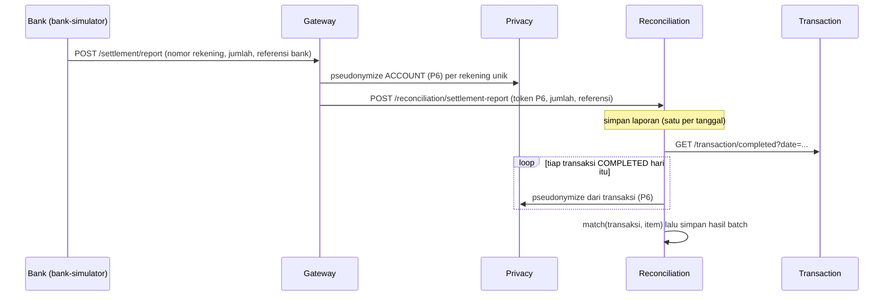

# 03. Alur end-to-end

Tiap alur ditulis langkah demi langkah dengan nama berkas dan fungsi, untuk **mode proposed** lalu **mode baseline**. Semua alur proposed di bagian A sampai G sudah saya jalankan sungguhan di [bab 01](01-menjalankan-sistem.md) (contoh jawaban ada di sana). Alur baseline saya telusuri dari kode dan dari tes E2E `services/gateway/test/e2e/equivalence.integration.spec.ts`; yang tidak saya jalankan manual ditandai.

Bacalah dengan membuka berkas yang disebut. Nama fungsi dipakai sebagai petunjuk (nomor baris berubah, nama jarang).

Notasi token: P1 sampai P7 adalah konteks Tabel 1 ([`services/privacy-service/src/policy/tables.ts`](../../services/privacy-service/src/policy/tables.ts), `TABLE_1`): P1 pelanggan untuk Transaction, P2 rekening untuk Transaction, P3 pelanggan untuk Fraud, P4 pelanggan untuk Notification (sekali pakai per transaksi), P5 pelanggan untuk Notification (pendaftaran, umur panjang), P6 rekening untuk Reconciliation, P7 pelanggan untuk audit.

---

## A. Registrasi pelanggan (`POST /register`)

Berkas: [`services/gateway/src/registration.ts`](../../services/gateway/src/registration.ts), `RegistrationFlow.register`. Urutan A2, A5, A3, A4 (ADR-0005).



**Proposed, langkah demi langkah**

1. `Gateway.handle` mengenali `POST /register` dan menghitung laju per alamat sumber (`register:<ip>`, K-14), lalu memeriksa ukuran maksimum 16 KiB.
2. `RegistrationFlow.register` memvalidasi **seluruh** formulir dulu dengan skema ketat (`registrationBody`): NIK 16 digit, nama huruf, HP `08...`, email, rekening, username. Field lain ditolak.
3. **A2** `createUser`: `POST /admin/users` ke dev-idp dengan token layanan untuk audience `dev-idp`. Hanya `{username}` yang dikirim (N-08). Tidak idempoten, jadi tidak diulang.
4. **A5** `privacy.storeIdentity` (`HttpPrivacyPort.storeIdentity`): `POST /identity` ke Privacy. Di Privacy: `IdentityVault.store` ([`services/privacy-service/src/identity/identity-vault.ts`](../../services/privacy-service/src/identity/identity-vault.ts)) memeriksa format lima nilai, kunci penasihat per pelanggan, lalu menulis lima kolom terenkripsi (tiap kolom dengan IV acak dan AAD berisi nama kolom serta id baris). Satu baris audit `STORE_IDENTITY`. Email **dibuang**: brankas tidak punya kolom email (N-38).
5. **A3** `privacy.pseudonymize`: token P5 untuk `NOTIFICATION` / `NOTIFICATION_REGISTRATION`.
6. **A4** `registerPhone`: `POST /notification/register` ke Notification dengan `notification_domain_id = token P5` dan HP. Notification mengupsert `contact_registry`.
7. Kegagalan di langkah mana pun setelah A2 menjalankan **kompensasi** (`compensate`): `revokeCustomer` (`POST /subject/revoke` memakai hak khusus Gateway, ADR-0014; mengosongkan brankas dan mencabut token) lalu `DELETE /admin/users/{customer_id}`. Kegagalan hilir dijawab 503; sebuah `DomainError` yang sudah punya alasan (mis. nama pengguna terpakai) diteruskan dengan alasannya (kode `register` dan `compensate`).

Hasil di penyimpanan: identitas hanya di `identity_vault` (terenkripsi). HP di `contact_registry` (satu-satunya tempat HP di luar Privacy). Tidak ada NIK, nama, email di layanan lain.

**Baseline.** `PassthroughPrivacyPort` dipakai: `storeIdentity` dan `revokeCustomer` tidak melakukan apa pun; `pseudonymize` mengembalikan `customer_id` itu sendiri (setelah cek bentuk `CUST-nnnnnn`). `registerPhone` memeriksa bentuknya dengan bentuk baseline (`domainRef`) dan Notification menyimpan HP di bawah `customer_id`. **Akibatnya NIK, nama, dan rekening dari formulir tidak disimpan di mana pun pada baseline** (tidak ada brankas; N-47). Alur ini terbukti lewat tes E2E (`leaveATrail` di `equivalence.integration.spec.ts`: `POST /register` mengembalikan 201 di baseline). Tidak saya jalankan manual.

---

## B. Satu transaksi (`POST /transaction`)

Berkas utama: [`services/gateway/src/gateway.ts`](../../services/gateway/src/gateway.ts) (`handle`, `tokenized`), [`services/gateway/src/tokenizer/tokenizer.ts`](../../services/gateway/src/tokenizer/tokenizer.ts) (`transaction`), [`services/transaction-service/src/transaction/processor.ts`](../../services/transaction-service/src/transaction/processor.ts) (`process`, `orchestrate`, `decide`), [`followups.ts`](../../services/transaction-service/src/transaction/followups.ts).

```mermaid
sequenceDiagram
  participant K as Nasabah
  participant G as Gateway
  participant P as Privacy
  participant T as Transaction
  participant F as Fraud
  participant N as Notification
  K->>G: POST /transaction (rekening, merchant, jumlah, geohash) + Idempotency-Key
  G->>G: JWT, laju, rute, peran, skema; customer_id dari klaim JWT
  G->>P: pseudonymize CUSTOMER (P1) dan ACCOUNT (P2), transaction_id baru
  P-->>G: dua token
  G->>T: POST /transaction (customer_token, account_token, ... tanpa identitas)
  T->>T: insertPending (ON CONFLICT DO NOTHING)
  alt jumlah >= ambang
    T->>P: exchange P1 -> P3 (token Fraud)
    T->>F: POST /fraud/assess
    F-->>T: skor, ALLOW / HOLD / BLOCK
  end
  T->>T: finish (COMPLETED / HELD / FAILED)
  T->>P: exchange P1 -> P4 (token Notification)
  T->>N: POST /notification/send
  N->>P: resolve-domain P4 -> P5
  T->>P: PATCH /transaction-status
  T-->>G: 201 {transaction_id, status}
  G-->>K: 201
```

**Proposed, langkah demi langkah**

1. `Gateway.handle`: `authenticate` dengan `acceptCustomerToken: true` (hanya Gateway menerima token nasabah), hitung laju, cocokkan rute `AZ-03`, `mayCall` (harus `CUSTOMER` dengan `customerId`), periksa ukuran dan skema `transactionBody`.
2. `Gateway.tokenized` mengambil header `idempotency-key` (harus string tunggal) dan **`customer_id` dari klaim JWT yang terverifikasi, bukan dari body** (invarian 7).
3. `Tokenizer.transaction`: membuat `transaction_id` (`TX-` + epoch ms + penghitung, K-17) lalu `Promise.all` dua `pseudonymize` (CUSTOMER dan ACCOUNT, tujuan `TRANSACTION` / `PAYMENT_PROCESSING`). Bila salah satu gagal, **seluruh permintaan gagal** dan tidak ada yang diteruskan (gagal tertutup). Payload keluar disusun dari daftar izin: `transaction_id`, `idempotency_key`, `customer_token`, `account_token`, `merchant_id`, `amount`, `geohash`.
4. Di Privacy, `TokenService.generate` (form 1): `PolicyEngine.evaluate` (Tabel 3: pemanggil `API_GATEWAY`, konteks P1/P2), lalu `issue`: kunci penasihat per kombinasi, tandai token kedaluwarsa, **pakai ulang** token aktif yang ada atau enkripsi subjek dan sisipkan baris baru (`ON CONFLICT (pseudonym) DO NOTHING`, ulangi sampai 20 kali bila tabrakan), tulis `transaction_link`, satu baris audit.
5. `TransactionHttp.create` ([`transaction-http.ts`](../../services/transaction-service/src/transaction-http.ts)): pemanggil harus `API_GATEWAY` (selain itu `POLICY_NOT_ALLOWED`), baru skema dibaca; token harus berbentuk `PSEU-XXXXXXXX`.
6. `TransactionProcessor.process`: jumlah bilangan bulat >= 1, pedagang ada, lalu `insertPending`. `ON CONFLICT DO NOTHING` berarti dua permintaan bersamaan dengan kunci yang sama menghasilkan tepat satu pemenang. Pemenang menjalankan `orchestrate`; yang kalah menjalankan `replay` (di bawah).
7. `decide`: jumlah < `FRAUD_AMOUNT_THRESHOLD` langsung `COMPLETED` tanpa bertanya ke Fraud. Jika tidak: `followups.withReissue` membungkus `subjects.forFraud(row)` (`ProposedSubjectReferences`: `HttpPrivacyClient.exchange` P1 ke P3) dan `fraud.assess`. Verdict `ALLOW` menjadi `COMPLETED`, `BLOCK` menjadi `FAILED`, `HOLD_FOR_VERIFICATION` menjadi `HELD`. **Fraud mati, timeout, atau pertukaran gagal berarti `HELD` dengan `FRAUD_UNAVAILABLE`, tidak pernah `COMPLETED`** (NFR-24). Panggilan Fraud tidak diulang (`idempotent: false`).
8. `repository.finish` memindahkan status hanya dari `PENDING` (penjaga di SQL). Jika sweeper sudah menandai `FAILED` lebih dulu, jawaban memakai status yang tersimpan.
9. `followups.notify` lalu `followups.patchPrivacy`. **Urutannya notifikasi dulu, baru PATCH**, karena Privacy menolak `re-issue` untuk transaksi yang sudah final (`TX_TERMINAL`); ini penyimpangan dari urutan spek, tercatat di komentar `orchestrate` dan spek transaksi.
10. `notify`: `subjects.forNotification` (exchange P1 ke P4), `notifications.send`. Di Notification `NotificationService.send`: `privacy.resolveDomain(token P4)` (Privacy memberi token P5 dari subjek yang sama), `contacts.phoneOf`, `sms.send`, satu baris `notification_log`. Kegagalan di mana pun hanya mencatat peringatan; status transaksi tidak berubah.
11. Bila token kedaluwarsa di tengah jalan (`TokenExpiredError`, jawaban 410 `EXPIRED` dari Privacy), `withReissue` meminta Privacy menerbitkan ulang kedua token (`reissue`), menyimpannya (`updateTokens`), dan mencoba langkah itu **sekali lagi** (TF-04).
12. Jawaban `201 {transaction_id, status}`. Selain itu, `POST /transaction` yang sama (kunci sama, isi sama) menjawab `200` dengan data tersimpan; isi berbeda `409 IDEMPOTENCY_CONFLICT` (`replay`, `sameContent`, ADR-0009).

**Baseline.** Langkah 1 sampai 2 sama. Langkah 3: `PassthroughPrivacyPort.pseudonymize` mengembalikan `customer_id` dan nomor rekening **apa adanya**, sehingga `customer_token` dan `account_token` (nama kawat tidak berubah) berisi identitas; Privacy tidak dipanggil. Langkah 5: Transaction memvalidasi dengan bentuk baseline (`CUST-nnnnnn`, 8 sampai 20 digit). Langkah 6: baris disimpan di kolom `customer_id` dan `account_number`. Langkah 7 dan 10: `BaselineSubjectReferences.forFraud/forNotification` mengembalikan `customer_id`; tidak ada pertukaran. Langkah 9: `BaselinePrivacyStatus.patchStatus` tidak melakukan apa-apa dan baris langsung ditandai sudah didengar. Langkah 11: `reissue` mengembalikan rujukan yang sama (identitas tidak kedaluwarsa). Hasil yang dilihat pengguna (status, SMS, skor) sama dengan proposed; itulah yang dibuktikan `equivalence.integration.spec.ts`.

---

## C. Deteksi fraud dan notifikasi (rincian dua langkah dari B)

**Fraud** ([`services/fraud-service/src/risk/assessor.ts`](../../services/fraud-service/src/risk/assessor.ts), `FraudAssessor.assess`):

1. `FraudHttp.assess`: pemanggil harus `TRANSACTION`; input `{pseudonym, amount, tx_hour, geohash}` (ketat). `pseudonym` berisi token P3 di proposed, `customer_id` di baseline.
2. Hitung `since = sekarang - FRAUD_HISTORY_DAYS`, ambil `history(pseudonym, since)` dan `rules()` bersamaan.
3. `RiskEngine.evaluate`: empat aturan berbobot; bobot dibaca dari `risk_rules` pada setiap penilaian. Riwayat kosong (cold start) melewati dua aturan profil.
4. Tulis **satu** baris `fraud_assessments` (token, jumlah, jam, geohash, skor, aturan yang menyala; tanpa `transaction_id`) lalu kembalikan hasil.
5. Contoh nyata dari run: 1.000.000 dari `qqgu7` pertama kali = skor 10 `ALLOW`; 8.000.000 dari `qqt8h` berikutnya = 10 (jumlah) + 25 (lebih dari 3x rata-rata) + 20 (lokasi baru) = 55 `HOLD_FOR_VERIFICATION`.

**Transaksi `HELD` dan keputusan analis** ([`transaction/review.ts`](../../services/transaction-service/src/transaction/review.ts)): `GET /transaction/held` memberi daftar (kursor keyset, hanya jumlah, skor, keputusan). `POST /transaction/{id}/review` (analis): `decideHeld` mengunci baris `FOR UPDATE`, `APPROVE` menjadi `COMPLETED` (mengisi `completed_at`), `REJECT` menjadi `FAILED`; `reviewed_by` diambil dari `sub` token aktor, tidak pernah dari body. Selain status `HELD` jawabannya `409 NOT_HELD`. Lalu `notify` dan `patchPrivacy` seperti di B.

**Baseline.** `FraudAssessor` identik; hanya SQL riwayat yang memilih `customer_id` (bukan `pseudonym`). Batas 30 hari sama.

---

## D. Pembukaan identitas bersyarat (audit rutin, empat mata, `de-pseudonymize`)

Tiga tahap terpisah, sesuai D-01 sampai D-05. **Hanya proposed.**



**Tahap 1, audit rutin tanpa identitas.** `ReconciliationService.auditRequest` ([`services/reconciliation-service/src/reconciliation/service.ts`](../../services/reconciliation-service/src/reconciliation/service.ts)): aktor harus `auditor` (`ReconciliationHttp.auditor`, selain itu `FORBIDDEN_ROLE`), `transactions.byId` (memastikan transaksi ada, `TRANSACTION_NOT_FOUND`), `privacy.auditToken` (di Privacy: `TokenService.generateFromTransaction`, bentuk 3; konteks P7 menuntut `actorRole === 'auditor'`; sumbernya baris P1 lewat `transaction_link`), lalu satu baris `audit_requests`. Jawaban: `request_id`, `transaction_id`, `audit_token`, `amount`, `status`. Tidak ada `customer_id`, NIK, atau nama.

**Tahap 2, permintaan dan persetujuan.** `DisclosureService.request` ([`services/privacy-service/src/disclosure/disclosure-service.ts`](../../services/privacy-service/src/disclosure/disclosure-service.ts)): pemanggil `ADMIN_CONSOLE` dengan peran `auditor` (`refuseUnlessPerson`), dasar harus salah satu dari `DISPUTE` / `FRAUD_CONFIRMED` / `LEGAL_REQUEST` (Tabel 6; selain itu `INVALID_BASIS`), atribut harus subset `customer_id`, `nik`, `nama` (Tabel 5; selain itu `ATTRIBUTE_NOT_ALLOWED`), token harus P7 milik `RECONCILIATION` / `INTERNAL_AUDIT`, belum dicabut atau kedaluwarsa. Baris `disclosure_request` berstatus `PENDING`. `approve`: peran `admin`; baris dikunci; harus `PENDING` (`DISCLOSURE_NOT_PENDING`); `requester_id` tidak boleh sama dengan aktor (`SELF_APPROVAL`; database juga memaksa lewat `chk_four_eyes`); status `APPROVED`, `expires_at` = sekarang + `DISCLOSURE_APPROVAL_TTL_SECONDS` (600).

**Tahap 3, pembukaan.** `Reconciliation.disclose` memanggil `privacy.open` (`HttpPrivacyClient.open`, tidak diulang) yang menjadi `POST /de-pseudonymize`. Di Privacy, `DePseudonymizeService.open` ([`de-pseudonymize-service.ts`](../../services/privacy-service/src/disclosure/de-pseudonymize-service.ts)), semuanya dalam satu transaksi dan satu baris audit:

| Langkah | Pemeriksaan | Penolakan (reason) |
| --- | --- | --- |
| STEP 0 | pemanggil `RECONCILIATION` (Tabel 3), lalu aktor berperan `auditor` | `POLICY_NOT_ALLOWED`, `FORBIDDEN_ROLE` |
| Gerbang 1 | token ada | `TOKEN_NOT_FOUND` |
| Gerbang 2 | `service_id` token = pemanggil | `SERVICE_MISMATCH` |
| Gerbang 3 | `purpose` token = yang diminta | `PURPOSE_MISMATCH` |
| Gerbang 4 | status efektif token (dengan masa tenggang) | `REVOKED`, `EXPIRED`; identitas sudah dikosongkan: `TOKEN_NOT_FOUND` |
| Gerbang 5 | `disclosure_request` milik token ini: ada; `APPROVED`; belum lewat `expires_at`; pemohon = aktor | `DISCLOSURE_NOT_FOUND`, `DISCLOSURE_NOT_APPROVED`, `DISCLOSURE_EXPIRED`, `REQUESTER_MISMATCH` |
| sesudahnya | `PolicyEngine.attributesFor` (hanya P7 yang boleh dibuka), brankas masih ada, lalu `UPDATE ... SET status='USED' WHERE status='APPROVED'` | `POLICY_NOT_ALLOWED`, `TOKEN_NOT_FOUND`, `DISCLOSURE_NOT_APPROVED` (bila dua pemakaian berebut) |

Hanya kolom yang **disetujui dan** ada di Tabel 5 yang didekripsi (`vaultBinding(kolom, id)` sebagai AAD); HP dan rekening tidak pernah dibaca oleh kueri ini (`findVault` hanya memilih tiga kolom). Jawaban `{mapping_id, attributes}` dengan `Cache-Control: no-store`. Baris audit memuat **nama** atribut (`attribute_names`), tidak pernah nilainya.

Catatan penting: kode memakai **lima gerbang** (ditambah STEP 0 untuk pemanggil dan peran). Bahasa PRD kadang menyebut "empat gerbang" (E-01 di [`docs/OPEN_QUESTIONS.md`](../OPEN_QUESTIONS.md)); jawabannya lima gerbang plus dua syarat tambahan. Urutan peran-lebih-dulu adalah penyimpangan dari spek yang disetujui (N-29).

Contoh nyata dari run (bab 01): token P7 `PSEU-80995ADF`, permintaan atribut `nama`, persetujuan oleh admin lain, pembukaan menghasilkan `{"attributes":{"nama":"Kenari Demo"}}`, pembukaan kedua `403`, dan audit mencatat satu `SUCCESS` dengan `attribute_names:["nama"]` dan satu `DENIED DISCLOSURE_NOT_APPROVED`.

**Baseline.** Tidak ada. `BaselinePrivacyClient.auditToken` dan `open` menolak dengan `SERVICE_UNAVAILABLE` (503), karena lapisan audit dan pembukaan identitas adalah bagian dari lapisan privasi (tes TK-xx hanya berlaku di proposed, ADR-0006 butir 5; N-47). `POST /reconciliation/audit-request` di baseline berakhir 503 dan tidak mencatat apa pun. Terbukti oleh tes `services/reconciliation-service/test/mode.integration.spec.ts`.

---

## E. Revocation (pencabutan)

Berkas: [`services/privacy-service/src/revocation/revocation-service.ts`](../../services/privacy-service/src/revocation/revocation-service.ts).

- `POST /pseudonym/{p}/revoke` (admin): `revokeToken` mengunci baris token, menandai `revoked` dan `revoked_at`; token kedaluwarsa pun bisa dicabut, dan pencabutan ulang idempoten (K-11). Satu baris audit.
- `POST /subject/revoke` (admin, atau Gateway untuk pelanggan, ADR-0014): `revokeSubject` mencari semua token aktif subjek lewat **blind index** (`BlindIndex.lookup`), mencabutnya dalam satu pernyataan (`REVOCATION_SQL.revokeSubject`, baris dikunci berurutan id), dan bila subjeknya pelanggan **mengosongkan brankas** (`IdentityVault.purge`: semua kolom terenkripsi dan `customer_lookup` menjadi `NULL`, `purged_at` diisi, baris tetap ada). Satu baris audit per token ditambah satu `PURGE_IDENTITY`. Bila tidak ada apa-apa, jawabannya 200 dengan `revoked_count: 0` dan satu baris `DENIED TOKEN_NOT_FOUND`.
- Efek: `exchange`, `re-issue`, `resolve-domain`, `de-pseudonymize` menolak token `revoked` dengan `REVOKED`; `generateFromTransaction` menolak sumber yang dicabut (K-29). Gateway tetap boleh menerbitkan token **baru** untuk subjek yang sama (batas yang diketahui; run di bab 01 langkah 21).

**Baseline.** Tidak ada Privacy, jadi tidak ada pencabutan; `PassthroughPrivacyPort.revokeCustomer` hanya menyelesaikan kompensasi registrasi tanpa melakukan apa pun.

---

## F. Retensi

Berkas: [`services/privacy-service/src/retention/retention-job.ts`](../../services/privacy-service/src/retention/retention-job.ts), `RetentionJob.run`. Dijadwalkan harian pada `RETENTION_JOB_RUN_UTC` (bawaan contoh 01:00 UTC) oleh `schedulerProviders` di `privacy.module.ts`; tidak jalan di `NODE_ENV=test`.

1. `markExpired`: token `active` yang melewati `expires_at` ditambah masa tenggang menjadi `expired` (baris yang sedang dikunci transaksi lain dilewati, `SKIP LOCKED`).
2. `purgeBatch` (500 baris per transaksi): baris `expired` atau `revoked` yang lebih tua dari `RETENTION_DAYS` (90 hari, pilihan peneliti, bukan standar) dikosongkan: `subject_id_enc` dan `subject_lookup` menjadi `NULL`, `purged_at` diisi. Barisnya **tidak dihapus**, supaya `audit_log.mapping_id` tetap valid.
3. `transaction_link` untuk token itu dihapus dalam transaksi yang sama.
4. Satu baris audit `PURGE_IDENTITY` per baris, pelaku `SYSTEM`, layanan `PRIVACY_SERVICE` (K-32).
5. **Brankas identitas tidak ikut retensi**; ia hanya dikosongkan lewat `revoke_subject`.

Setelah dikosongkan, token itu tidak bisa lagi ditukar, diterbitkan ulang, atau dibuka (`TOKEN_NOT_FOUND`). Bukti: tes `services/privacy-service/test/retention.integration.spec.ts` dan `services/gateway/test/e2e/scheduler.integration.spec.ts` (S-36). **Baseline:** tidak ada.

---

## G. Rekonsiliasi harian



**Proposed**

1. Laporan bank: `Gateway` rute `AZ-09` (`caller: 'bank'`). `Tokenizer.settlement` memvalidasi **seluruh** laporan dulu (maksimal 500 item, 64 KiB), lalu meminta token P6 per rekening unik (16 paralel) dan mengganti `account_number` dengan token. Reconciliation hanya menerima `account_pseudonym` (skema ketat menolak nomor rekening).
2. `ReconciliationService.receiveReport` → `repository.storeReport`: satu laporan per tanggal. Isi sama lagi menjawab 200; isi berbeda menjawab `409 IDEMPOTENCY_CONFLICT` (K-22). Yang saya alami di bab 01: laporan bank-simulator sudah mengisi tanggal itu, jadi laporan buatan sendiri sesudahnya ditolak 409.
3. `run(date)` (admin, atau penjadwal `RECON_DAILY_RUN_UTC` untuk kemarin): `transactions.completedOn(date)` membaca halaman demi halaman (kursor); untuk tiap transaksi `privacy.accountSubjectRef(transactionId)` meminta token P6 dari Privacy (Privacy menurunkan rekening dari baris P2 lewat `transaction_link`).
4. Token P6 yang tidak ada lagi (`TOKEN_NOT_FOUND`, `REVOKED`) membuat transaksi **tidak berpasangan**, batch lanjut. Jawaban lain dari Privacy atau Transaction (5xx, timeout) menghentikan run dengan 503 **sebelum batch disentuh** (gagal tertutup, K-22).
5. `match` memasangkan `(rujukan rekening, jumlah)` satu lawan satu; `repository.settle` menyimpan hasilnya dan memperbarui batch (`tx_count`, `total_amount`, `status`).

**Baseline.** Langkah 1: `account_number` diteruskan apa adanya (token = nomor rekening). Langkah 3: `BaselinePrivacyClient.accountSubjectRef` memanggil `TransactionClient.byId` dan memakai `account_number` pada jawaban (perluasan kontrak N-46); transaksi yang tidak dikenal dihitung tidak berpasangan. Langkah 5 sama persis. Hasil `run` sama dengan proposed untuk data yang sama (tes kesetaraan).

---

## Alur kecil lain yang sering ditanyakan

- **Mati-nya Privacy Service.** Gateway: `pseudonymize` gagal menjadi `SERVICE_UNAVAILABLE`, permintaan berhenti dan tidak ada data diteruskan (503). Di Transaction: pertukaran gagal untuk Fraud menjadi `HELD`; untuk notifikasi menjadi peringatan; PATCH yang gagal ditandai belum didengar dan diulang oleh `PendingSweeper.resync` tiap `TX_SWEEP_INTERVAL_SECONDS`. Di Notification: `resolveDomain` gagal menjadi `FAILED`. Diuji di tingkat Gateway dengan Privacy asli dihentikan; **dengan Docker belum diuji** (M7).
- **`PENDING` yang macet.** `PendingSweeper.sweep` menandai `FAILED` baris `PENDING` yang lebih tua dari `TX_PENDING_TIMEOUT_SECONDS` (300).
- **Rate limit.** `RateLimiter.allow` per `<jenis pemanggil>:<subjek>`, 100 per menit (`RATE_LIMIT_PER_MINUTE`), jendela tetap satu menit di memori.
