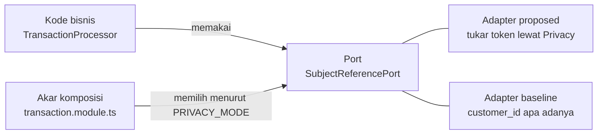

# 05. Mode baseline dan proposed

Ringkasan dan tautan ke penjelasan pemula yang sudah ada: [`docs/PENJELASAN_MODE_BASELINE.md`](../PENJELASAN_MODE_BASELINE.md). **Perhatikan:** berkas itu ditulis pada akhir M5 sesi 1 dan bagian statusnya sudah usang (ia masih berkata colokan "belum dipasang ke layanan yang berjalan"). Sejak M5 sesi 2 semua layanan membaca `PRIVACY_MODE` dan memasang adaptornya. Bagian "Satu panggilan transaksi" di sana masih benar secara garis besar; untuk rincian terkini pakai bab ini dan [03](03-alur-end-to-end.md).

## Gagasannya, untuk yang baru di ports-and-adapters

Pola **ports-and-adapters** (juga disebut hexagonal) memisahkan *apa yang dibutuhkan kode bisnis* dari *bagaimana kebutuhan itu dipenuhi*:

- **Port** = antarmuka kecil yang ditulis dari sudut pandang kode bisnis. Contoh: `SubjectReferencePort` ([`services/transaction-service/src/transaction/ports.ts`](../../services/transaction-service/src/transaction/ports.ts)) berkata, "beri aku rujukan pelanggan untuk Fraud, untuk Notification, dan terbitkan ulang bila kedaluwarsa". Kode bisnis (`TransactionProcessor`) hanya mengenal port ini.
- **Adapter** = kelas yang memenuhi port itu dengan cara tertentu. Ada dua: `ProposedSubjectReferences` (menukar token lewat Privacy) dan `BaselineSubjectReferences` (mengembalikan `customer_id` apa adanya).
- **Akar komposisi** = satu tempat yang merakit semuanya saat proses start dan memilih adaptor ([`transaction.module.ts`](../../services/transaction-service/src/transaction.module.ts)).

Mengapa ini penting bagi skripsi: kalau kode bisnis berbeda antar-mode, perbedaan hasil pengukuran tidak bisa dikaitkan ke lapisan privasi. Dengan pola ini hanya "colokan" yang berbeda, dan itu **dibuktikan**, bukan diasumsikan (ADR-0006, [`docs/adr/0006-dua-mode-lewat-repositori.md`](../adr/0006-dua-mode-lewat-repositori.md)).

Ada dua jenis colokan, keduanya dipilih di akar komposisi:

1. **Adaptor ke Privacy** (port tersendiri per layanan, tabel di bawah).
2. **Repositori dengan SQL per mode.** Satu kelas repositori per layanan (misalnya `TransactionRepository`) yang menerima objek `SubjectSql`: kumpulan pernyataan SQL yang menyebut kolom subjek. `proposed/subject-sql.ts` menyebut `customer_pseudonym`, `baseline/subject-sql.ts` menyebut `customer_id`. Seluruh SQL lain identik (keputusan N-43). Karena SQL berparameter dilarang digabung dari string, dua versi pernyataan memang harus ditulis terpisah, bukan dihasilkan dari satu templat.

## Penjaga supaya kode bisnis tidak bocor ke mode

- **Tes arsitektur** [`tests/repo/mode-folders.spec.ts`](../../tests/repo/mode-folders.spec.ts): gagal bila kode domain (di luar `*.module.ts`, `main.ts`, dan folder `proposed/` atau `baseline/`) mengimpor folder mode atau migrasi, atau menyebut kata `PRIVACY_MODE`, `'baseline'`, `'proposed'`. Mencakup Transaction, Fraud, Notification, Reconciliation, dan Gateway. Gateway hanya diwajibkan punya folder `baseline/`; adaptor proposed-nya (`HttpPrivacyPort`) ada di `tokenizer/` sejak sebelum pola ini.
- **Pabrik baseline menolak mode lain**: tiap pabrik baseline (mis. `baselineTransactionRepository`, `baselinePrivacyStatus`, `baselinePrivacyPort`) memanggil `assertBaselineMode(mode)` ([`packages/common/src/mode.ts`](../../packages/common/src/mode.ts)), yang melempar bila `PRIVACY_MODE` bukan `baseline`. Alasannya: kode baseline memegang identitas asli.
- **Aturan env saat start**: `PRIVACY_SERVICE_URL` wajib di proposed dan dilarang di baseline (empat layanan); Privacy Service menolak start di baseline (`privacyUrlMatchesMode`, N-47). Pesan galat hanya menyebut nama variabel.
- **Bentuk rujukan di tepi HTTP** per mode (`subjectRefShape`): proposed hanya menerima `PSEU-XXXXXXXX`, baseline hanya `CUST-nnnnnn` dan 8 sampai 20 digit rekening. Nama field di kawat (`customer_token`, `account_token`, `pseudonym`, `notif_token`, `account_pseudonym`) **tidak berubah**, sehingga di baseline field bernama "token" berisi identitas (tercatat sebagai kekurangan penamaan, bukan perilaku).

## Apa yang sama

Autentikasi dan otorisasi (JWT, pola dua token, peran), batas laju, validasi skema ketat, format error dan delapan kode klien, `transaction_id` dan idempotensi (ADR-0009), mesin status transaksi, aturan fraud dan jendela riwayat 30 hari, template SMS, pencocokan rekonsiliasi, penjadwal job, logger. Itu semua kode di folder domain, tidak bercabang menurut mode.

## Apa yang berbeda

| Aspek | Proposed | Baseline |
| --- | --- | --- |
| Privacy Service | berjalan; satu-satunya pemegang pemetaan dan brankas | tidak ada; tidak dipanggil; menolak start |
| Gateway | `HttpPrivacyPort`: minta token P1/P2/P5/P6; simpan identitas di brankas saat registrasi | `PassthroughPrivacyPort`: meneruskan `customer_id` dan rekening apa adanya; registrasi tidak menyimpan NIK atau nama |
| Transaction | tabel dengan `customer_pseudonym`, `account_pseudonym`; tukar token untuk Fraud dan Notification; PATCH status ke Privacy | tabel dengan `customer_id`, `account_number`; tanpa pertukaran; `BaselinePrivacyStatus` tidak melakukan apa-apa |
| Fraud | riwayat dikunci `pseudonym` (token P3) | riwayat dikunci `customer_id` |
| Notification | kontak dikunci token P5; `resolve-domain` ke Privacy | kontak dikunci `customer_id`; `BaselinePrivacyClient` mengembalikan token apa adanya; kolom log bernama `*_customer_id` |
| Reconciliation | laporan dan pencocokan dengan token P6; audit rutin dan pembukaan identitas | laporan dan pencocokan dengan nomor rekening; rekening per transaksi dari `GET /transaction/{id}` Transaction (N-46); audit dan pembukaan dijawab 503 |
| Audit, token, revocation, retensi, pembukaan identitas empat mata | ada | tidak ada |
| Jumlah kolom identitas di basis data hilir | 0 (proposed) | `customer_id`, `account_number`, dst. |
| Proses yang berjalan | 9 | 8 (tanpa Privacy) |

## Kesetiaan baseline terhadap harapan E(s)

Dua kelompok sumber tidak sepakat tentang apa yang diterima layanan hilir di baseline. Spek per layanan (`transaction.md`, `fraud.md`, `notification.md`, `reconciliation.md`, `data-dan-migrasi.md` bagian 9, PRD 11) hanya mengganti pengenal: `customer_id` dan `account_number`. Spek Gateway bagian 8 dan Tabel IV metodologi ([`docs/spec/pengujian-dan-pengukuran.md`](../spec/pengujian-dan-pengukuran.md) bagian 6) berkata baseline meneruskan atribut mentah, dengan E(s) Transaction, Fraud, Reconciliation = **4/6** dan Notification = **5/6**. Analisis lengkap dengan kutipan dan path ada di [`docs/security/kesenjangan-baseline.md`](../security/kesenjangan-baseline.md).

Satu selisih sudah dibereskan karena dua sumber sepakat (G1, N-48): di baseline Gateway meneruskan `nik` dan `nama` yang dikirim klien pada `POST /transaction`, dan Transaction baseline menerimanya tanpa menyimpannya. Nilai yang akan teramati pada baseline, **turunan dari kode dan belum diukur oleh E(s) resmi** (M6-02):

| Layanan | Pengenal yang diterima di baseline (dari kode) | E(s) turunan | Harapan Tabel IV |
| --- | --- | --- | --- |
| Transaction | `customer_id`, rekening, dan `nik`, `nama` bila klien mengirimnya | 2/6 tanpa NIK dan nama, 4/6 dengan | 4/6 |
| Fraud | `customer_id` | 1/6 | 4/6 |
| Reconciliation | rekening | 1/6 | 4/6 |
| Notification | `customer_id`, HP | 2/6 | 5/6 |

Fraud, Reconciliation, dan Notification menunggu keputusan pemilik skripsi: pilih **A** (baseline hanya mengganti pengenal, Tabel IV diubah menjadi 2/6, 1/6, 1/6, 2/6) atau **B** (passthrough penuh; butuh migrasi baseline bila layanan harus menyimpan salinan). Email tidak diteruskan (G2 terbuka). Mohon jangan mengutip 4/6 dan 5/6 sebagai hasil pengukuran.

## Apa yang diukur (rencana) dan apa yang sudah ada

| Pengukuran | Apa | Status |
| --- | --- | --- |
| **Kesetaraan perilaku** (validitas internal) | skenario yang sama lewat Gateway dan semua layanan di kedua mode menghasilkan jawaban, baris, dan SMS yang sama | **sudah**: `services/gateway/test/e2e/equivalence.integration.spec.ts` (butir S-77) |
| **Mode benar-benar berbeda** | pemindai menemukan data asli di basis data baseline dan tidak di proposed | **sudah**: tes yang sama (S-76) |
| **E(s)** paparan struktural per layanan | `E(s)` = jumlah pengenal langsung yang diterima layanan `s` dibagi 6, atas enam pengenal (nama, NIK, HP, email, rekening, `customer_id`), dengan nilai kenari di tiga sasaran: payload antar-layanan, basis data, log | pemindai ada (M2-10); **laporan E(s) belum** (M6-02) |
| **Uji penautan** | seberapa besar rekaman satu subjek dapat ditautkan lintas basis data hilir; di proposed token berbeda per (layanan, tujuan) sehingga join lintas layanan diharapkan nol, tetapi penautan di dalam satu layanan selama TTL (30 hari di Fraud) tetap mungkin dan dilaporkan jujur | **belum** (M6-03, S-71, S-72) |
| **Gagal tertutup** | matikan Privacy saat transaksi berjalan, periksa 503 dan tidak ada payload mentah ke hilir | teruji di tingkat Gateway lokal; **dengan Docker belum** (M6-04, M7) |
| **Kinerja** | k6, 100 VU, 5 pengulangan bergantian per mode, ambang p95 +20% dan throughput -15% | **belum** (M7); angka lokal sengaja tidak diambil dan tidak boleh masuk laporan (ADR-0004) |
| TK-xx (keamanan) | hanya mode proposed (lapisan privasi) | sebagian besar lulus di lapis layanan; end-to-end lewat Newman belum (M6-01) |

## Ancaman validitas yang sudah diketahui

1. **N-45, jendela riwayat Fraud.** Disamakan 30 hari di kedua mode lewat SQL. Selisih yang tersisa: di proposed riwayat terikat token Fraud, jadi setelah token berganti riwayat lama tak terbaca walau masih dalam 30 hari; di baseline kunci `customer_id` tidak berganti. Ini efek mekanisme privasi, bukan rancangan eksperimen, dan harus dilaporkan. Ongkos kegunaan data: pemotongan 30 hari membuang riwayat lebih lama yang di baseline tersedia.
2. **N-46, kontrak Transaction.** Di baseline `GET /transaction/{id}` memuat `account_number` dan Reconciliation memanggilnya sekali per transaksi; di proposed rekening datang dari Privacy. Jumlah panggilan per transaksi di Reconciliation karenanya setara, tetapi targetnya berbeda.
3. **Registrasi baseline** tidak menyimpan NIK dan nama (tidak ada brankas), sedangkan proposed menyimpannya terenkripsi. Itu perbedaan fungsi yang disengaja, bukan efek privasi.
4. **Fitur yang hanya ada di proposed** (audit rutin, pembukaan identitas, retensi, revocation) tidak punya padanan baseline; dilaporkan terpisah sebagai paparan terkontrol, bukan dihitung dalam E(s) (D-23).
5. **Lingkungan.** Satu mesin, PostgreSQL 18 (target 16), dev-idp bukan Keycloak, Gateway lokal bukan Kong. Syarat validitas ADR-0004: pengukuran hanya sah pada konfigurasi final yang sama untuk kedua mode.
